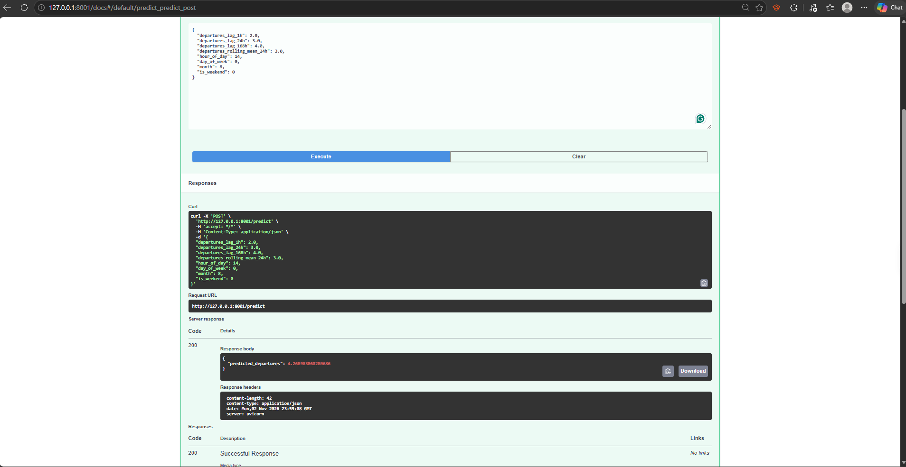

# TC5061 - Proyecto MiBici | Equipo 44

Proyecto integrador de la materia de MLOps (TC5061), desarrollado a partir de los datos abiertos del sistema de bicicletas públicas MiBici, en Guadalajara, México.

El objetivo es construir un flujo reproducible de ingesta de datos, *feature engineering*, entrenamiento de modelos de *machine learning*, validación de calidad de datos y seguimiento de experimentos con MLflow.

**Repositorio:** https://github.com/Equipo-MLOps-44/TC5061-Proyecto-Equipo44

## 1. Preguntas del proyecto

El proyecto busca responder tres preguntas mediante diferentes técnicas de *machine learning*.

| Pregunta | Objetivo | Tipo de problema |
|---|---|---|
| P1 | Predecir cuántos viajes se iniciarán en una estación durante una hora futura. | Regresión |
| P2 | Estimar si una estación estará en riesgo de quedarse sin bicicletas o sin espacios disponibles. | Clasificación |
| P3 | Identificar grupos de estaciones que comparten patrones de utilización similares. | Clustering |

P1 busca apoyar la planeación de la demanda, P2 el rebalanceo de bicicletas y P3 el análisis de estaciones para la planeación del sistema.

## 2. Datos utilizados

**Fuente:** [Portal de datos abiertos de MiBici](https://mibici.net/es/datos-abiertos/).

El proyecto utiliza registros mensuales de viajes y el archivo de nomenclatura de estaciones, que contiene identificadores, ubicaciones y capacidades.

En la ejecución documentada se procesaron:

| Elemento | Cantidad |
|---|---:|
| Periodo | Octubre de 2024 – septiembre de 2026 |
| Archivos mensuales | 24 |
| Viajes procesados | 9,043,925 |
| Registros por estación y hora | 6,662,294 |
| Perfiles de estaciones | 472 |

La ingesta normaliza los nombres de columnas, las codificaciones y los campos de fecha. Los datos se procesan por lotes y se almacenan en formato Parquet.

**Periodo fijo de ingesta.** El módulo `dataset.py` selecciona exactamente los 24 archivos mensuales de **octubre de 2024 a septiembre de 2026**, además de la nomenclatura de **septiembre de 2026**. Ya no utiliza los últimos 24 meses disponibles. Si falta alguno de los archivos esperados en la página de MiBici, el proceso informa un error antes de comenzar las descargas. Esta selección se comprueba mediante una prueba automatizada en `tests/test_data.py`, que también simula la publicación de un mes posterior.

No se incluyen datos individuales de MiBici en GitHub. Se utilizan las variables necesarias para el análisis y se evita publicar información personal en el repositorio.

### Versionamiento de datos

Se implementó un mecanismo de identificación de versiones mediante hashes SHA-256.

El módulo `data_version.py` calcula los hashes de los archivos CSV y del Parquet procesado, junto con sus cantidades de registros. Esta información se guarda en `references/data_manifest.json`.

La versión generada para la ejecución documentada es:

`e01da28b62056c69`

El manifiesto permite identificar y comprobar la integridad de los archivos utilizados sin incluir los datasets en Git. **Fijar las fechas no garantiza que el proveedor no modifique el contenido de los CSV**: los hashes del manifiesto permiten detectar esos cambios. Para reconstruir exactamente una versión es necesario conservar los archivos de origen correspondientes.

## 3. Estructura del repositorio

El repositorio utiliza la plantilla Cookiecutter Data Science.

```text
TC5061-Proyecto-Equipo44/
├── data/
│   ├── external/
│   ├── interim/
│   ├── processed/
│   └── raw/
├── notebooks/
├── references/
│   └── data_manifest.json
├── reports/
│   ├── figures/
│   └── deepchecks/                  # Reportes locales, ignorados por Git
├── models/
├── docs/
├── scripts/
│   ├── validate_mibici.py
│   └── validate_mibici_drift.py
├── tests/
│   └── test_data.py
├── tc5061_proyecto_equipo_44/
│   ├── config.py
│   ├── dataset.py
│   ├── data_version.py
│   ├── features.py
│   └── modeling/
│       ├── train.py
│       └── predict.py
├── MLproject
├── python_env.yaml
├── requirements.txt
├── requirements-deepchecks.txt
├── pyproject.toml
├── .gitignore
└── README.md
```

Las carpetas `data/`, `models/` y `reports/` separan los datos, los modelos y los resultados. La lógica principal de procesamiento y entrenamiento se encuentra en `tc5061_proyecto_equipo_44/`. Los scripts de DeepChecks están en `scripts/` y las pruebas automatizadas en `tests/`.

## 4. Instalación

Se requiere Python, Git y `uv`.

**Instalar `uv` en Windows** (si el comando no está disponible):

```powershell
winget install --id astral-sh.uv -e
```

Cierra y vuelve a abrir PowerShell y comprueba la instalación:

```powershell
uv --version
```

**Clonar el repositorio:**

```powershell
git clone https://github.com/Equipo-MLOps-44/TC5061-Proyecto-Equipo44.git
cd TC5061-Proyecto-Equipo44
```

**Crear y activar el entorno virtual principal (PowerShell):**

```powershell
uv venv --python 3.11
.\.venv\Scripts\Activate.ps1
```

**Instalar las dependencias**, incluido MLflow:

```powershell
uv pip install -r requirements.txt
```

Comprueba la instalación de MLflow:

```powershell
python -m mlflow --version
```

`requirements.txt` instala el proyecto en modo editable y contiene MLflow; no hace falta instalarlo por separado. **DeepChecks se instala en otro entorno**, siguiendo la sección 9, para evitar modificar las versiones del entorno principal.

## 5. Ejecución del pipeline

Los comandos se ejecutan desde la carpeta principal del repositorio.

### Ejecutar el MLproject con MLflow

El archivo `MLproject` define los entry points `ingest`, `features` y `train`. `python_env.yaml` especifica Python 3.11 y las dependencias para MLflow. Los siguientes comandos usan el entorno virtual principal ya instalado y activado.

```powershell
python -m mlflow run . -e ingest --env-manager=local --experiment-name mibici-equipo44
python -m mlflow run . -e features --env-manager=local --experiment-name mibici-equipo44
python -m mlflow run . -e train --env-manager=local --experiment-name mibici-equipo44 -P question=p1 -P model=baseline
```

Para ejecutar P3 se requiere `model=k_means`:

```powershell
python -m mlflow run . -e train --env-manager=local --experiment-name mibici-equipo44 -P question=p3 -P model=k_means
```

`--env-manager=local` ejecuta los entry points con el entorno virtual activo. `--experiment-name mibici-equipo44` asigna la ejecución de MLflow Projects al experimento del equipo.

### 5.1. Ingesta

```powershell
uv run --no-sync python -m tc5061_proyecto_equipo_44.dataset
```

Descarga los **24 CSV fijos de octubre de 2024 a septiembre de 2026**, junto con `nomenclatura_2026_09.csv`; procesa los viajes y genera `data/processed/dataset.parquet` y el manifiesto de versionamiento.

**Atención:** ejecutar este comando descarga y vuelve a procesar los archivos. Para comprobar la selección de fechas sin conectarse a internet, ejecuta la prueba indicada en la sección 9.

Para generar el manifiesto por separado, utilizando datos ya descargados:

```powershell
uv run --no-sync python -m tc5061_proyecto_equipo_44.data_version
```

### 5.2. Feature Engineering

```powershell
uv run --no-sync python -m tc5061_proyecto_equipo_44.features
```

Este proceso genera:

- `data/processed/hourly_features.parquet`: información por estación y hora para P1 y P2.
- `data/processed/station_profiles.parquet`: características agregadas de las estaciones para P3.

Las transformaciones se encuentran implementadas en `features.py` como funciones reutilizables.

Para P2 se aproxima el inventario a partir de la capacidad de cada estación y del flujo de salidas y llegadas. Se supone inicialmente un inventario equivalente al 75 % de la capacidad y se utilizan umbrales del 20 % para generar las etiquetas de riesgo. Estas etiquetas son estimadas, ya que los datos disponibles no contienen mediciones reales de bicicletas o espacios libres.

### 5.3. Entrenamiento de modelos

Las ejecuciones se realizan mediante el entry point `train` del archivo `MLproject`.

**P1 — Regresión, baseline:**

```powershell
uv run --no-sync mlflow run . -e train -P question=p1 -P model=baseline --env-manager local --experiment-name mibici-equipo44
```

**P1 — Tres configuraciones adicionales de Random Forest:**

```powershell
uv run --no-sync mlflow run . -e train -P question=p1 -P model=rf -P n_estimators=10 -P max_depth=6 --env-manager local --experiment-name mibici-equipo44 --run-name P1_RF_10_depth6
uv run --no-sync mlflow run . -e train -P question=p1 -P model=rf -P n_estimators=20 -P max_depth=8 --env-manager local --experiment-name mibici-equipo44 --run-name P1_RF_20_depth8
uv run --no-sync mlflow run . -e train -P question=p1 -P model=rf -P n_estimators=40 -P max_depth=10 --env-manager local --experiment-name mibici-equipo44 --run-name P1_RF_40_depth10
```

**P2 — Clasificación, baseline:**

```powershell
uv run --no-sync mlflow run . -e train -P question=p2 -P model=baseline --env-manager local --experiment-name mibici-equipo44
```

**P3 — Clustering:**

```powershell
uv run --no-sync mlflow run . -e train -P question=p3 -P model=kmeans --env-manager local --experiment-name mibici-equipo44
```

| Pregunta | Modelo baseline | Métricas de evaluación |
|---|---|---|
| P1 | DummyRegressor | MAE y RMSE |
| P2 | DummyClassifier | Accuracy, F1 y Recall |
| P3 | KMeans | Silhouette Score |

Para P1 y P2 se utiliza una división cronológica entre entrenamiento y prueba, con el objetivo de evitar incorporar información futura en el entrenamiento. En P3 se utilizan perfiles históricos agregados para identificar grupos de estaciones.

## 6. Experimentos con MLflow

El seguimiento de experimentos se realiza mediante MLflow Tracking.

**Nombre del experimento:** `mibici-equipo44`.

Se registraron cuatro ejecuciones baseline: una para P1, dos para P2 (una por cada variable de riesgo) y una para P3. También se ejecutaron tres configuraciones de Random Forest para P1.

| Modelo P1 | Árboles | Profundidad máxima | Test MAE | Test RMSE |
|---|---:|---:|---:|---:|
| DummyRegressor | — | — | 1.5655 | 2.4704 |
| Random Forest 1 | 10 | 6 | 0.8759 | 1.5687 |
| Random Forest 2 | 20 | 8 | 0.8449 | 1.5079 |
| Random Forest 3 | 40 | 10 | **0.8248** | **1.4711** |

La configuración de 40 árboles y profundidad 10 obtuvo el menor error en estas pruebas. Es un candidato provisional: para una selección definitiva conviene utilizar una validación separada del conjunto de prueba.

Los runs incluyen parámetros, métricas, etiquetas y artefactos, así como referencias al código utilizado. El módulo de P1 incorpora el manifiesto de datos a los experimentos nuevos; la disponibilidad de ese artefacto en corridas anteriores debe comprobarse en el servidor MLflow correspondiente.

Para consultar la interfaz local:

```powershell
uv run --no-sync mlflow ui --backend-store-uri sqlite:///mlflow.db --port 5000
```

Abrir en el navegador: http://127.0.0.1:5000

Los archivos locales de experimentos y modelos no se incluyen en GitHub.

## 7. Buenas prácticas y reproducibilidad

El proyecto aplica las siguientes prácticas:

- **Separación del código:** ingesta, características y entrenamiento se implementan en módulos independientes.
- **Configuración:** las rutas y variables compartidas se administran mediante `config.py`.
- **Datos:** los archivos originales y procesados se mantienen separados.
- **Versionamiento:** se utiliza un manifiesto con hashes SHA-256 para identificar los datos procesados.
- **Ingesta fija:** se selecciona siempre el periodo octubre de 2024 a septiembre de 2026.
- **Evaluación temporal:** P1 y P2 utilizan una partición cronológica para reducir el riesgo de fuga de información futura.
- **Validación de calidad:** DeepChecks verifica características de integridad y cambios de distribución sobre muestras reproducibles.
- **Experimentos:** MLflow permite consultar parámetros, métricas, etiquetas y artefactos.
- **Git:** `.gitignore` excluye datos, modelos serializados, archivos locales de MLflow, credenciales, entornos virtuales y reportes de DeepChecks.

Los archivos generados localmente no deben incorporarse al historial de Git.

## 8. Flujo de trabajo con Git y GitHub

El equipo desarrolla sus cambios mediante ramas independientes y Pull Requests.

1. Actualizar la rama compartida `develop`.
2. Crear una rama para la funcionalidad o corrección.
3. Implementar y probar los cambios.
4. Crear commits descriptivos.
5. Subir la rama a GitHub.
6. Abrir un Pull Request hacia `develop`.
7. Revisar e integrar los cambios.

Se utilizan nombres descriptivos para las ramas, como `fix/modeling-dependencies` y `docs/project-documentation`, así como convenciones de commits como `feat:`, `fix:` y `docs:`.

La actividad establece que la rama principal debe estar protegida y que cada integrante debe abrir al menos un Pull Request y realizar al menos una revisión. Estas condiciones deben comprobarse en GitHub antes de la entrega.

## 9. Validación de datos con DeepChecks

Se integró **DeepChecks** para revisar la integridad de los registros de viajes y detectar posibles cambios de distribución (*data drift*) entre las muestras de entrenamiento y prueba de P1. Esta validación no modifica los archivos originales ni reentrena modelos.

### 9.1. Entorno independiente

DeepChecks se ejecuta en un entorno separado para evitar conflictos con NumPy, Pandas y Scikit-learn del proyecto principal. **No es necesario cambiar las dependencias del entorno de MLflow.**

Desde la raíz del repositorio, en PowerShell:

```powershell
uv venv .venv-deepchecks --python 3.10
uv pip install --python .\.venv-deepchecks\Scripts\python.exe -r requirements-deepchecks.txt
```

El archivo `requirements-deepchecks.txt` fija las versiones utilizadas en las validaciones locales: DeepChecks 0.19.1, NumPy 1.26.4, Pandas 2.2.3, Scikit-learn 1.5.2, Setuptools 80.9.0 y PyArrow 25.0.1. El entorno `.venv-deepchecks/` está excluido de Git.

### 9.2. Validación de integridad de viajes

```powershell
.\.venv-deepchecks\Scripts\python.exe scripts/validate_mibici.py
```

El script lee `data/processed/dataset.parquet` por lotes y selecciona una **muestra aleatoria reproducible de 10,000 registros (semilla 42)**. Para evitar exponer identificadores individuales en el reporte, se analizan únicamente las columnas `genero`, `ano_de_nacimiento`, `inicio_del_viaje`, `fin_del_viaje`, `origen_id` y `destino_id`.

Los chequeos ejecutados son `ColumnsInfo`, `PercentOfNulls`, `MixedNulls`, `MixedDataTypes` y `DataDuplicates`.

**Resultados observados en la muestra:**

| Chequeo | Hallazgo |
|---|---|
| Valores nulos formales | 0 % en las columnas evaluadas por `PercentOfNulls` |
| Valores faltantes codificados como texto | `genero`: 79 valores `"NULL"` (0.79 %); `ano_de_nacimiento`: 7 valores `"NA"` (0.07 %) |
| Tipos mixtos | `ano_de_nacimiento` contiene principalmente años expresados como texto numérico, además de `"NA"` |
| Duplicados | 0 % de filas duplicadas **en las columnas muestreadas y analizadas** |

**Reportes locales:**

- `reports/deepchecks/integridad_viajes.html`: exportación HTML original de DeepChecks (puede visualizarse en blanco en determinados navegadores o entornos).
- `reports/deepchecks/integridad_viajes_simple.html`: versión estática alternativa con los resultados textuales, sin JavaScript.

Para abrir la versión estática en Windows:

```powershell
Invoke-Item .\reports\deepchecks\integridad_viajes_simple.html
```

Los porcentajes corresponden a la muestra analizada, **no al conjunto completo de 9,043,925 viajes**. Los textos `"NULL"` y `"NA"` requieren atención porque no se consideran automáticamente valores nulos formales.

### 9.3. Análisis de data drift

```powershell
.\.venv-deepchecks\Scripts\python.exe scripts/validate_mibici_drift.py
```

Se utiliza `data/processed/hourly_features.parquet` y un corte temporal de referencia en **2026-02-24**: los registros anteriores corresponden a entrenamiento y los posteriores o iguales a prueba. Se toman muestras reproducibles con semilla 42, de hasta 10,000 filas de cada periodo.

La validación compara las variables de P1: `departures_lag_1h`, `departures_lag_24h`, `departures_lag_168h`, `departures_rolling_mean_24h`, `hour_of_day`, `day_of_week`, `month` e `is_weekend`.

**Resultados observados:**

| Variable | Drift score | Método |
|---|---:|---|
| `month` | 0.6138 | Cramér's V |
| `departures_rolling_mean_24h` | 0.0614 | Kolmogorov-Smirnov |
| `departures_lag_168h` | 0.0366 | Kolmogorov-Smirnov |
| `departures_lag_24h` | 0.0313 | Kolmogorov-Smirnov |
| `departures_lag_1h` | 0.0262 | Kolmogorov-Smirnov |
| `hour_of_day` | 0.0123 | Cramér's V |
| `day_of_week` | 0.0000 | Cramér's V |
| `is_weekend` | 0.0000 | Cramér's V |

La diferencia más marcada dentro de las variables categóricas se observó en `month`, lo cual es compatible con una partición cronológica que abarca meses diferentes. **Los puntajes de Cramér's V y Kolmogorov-Smirnov utilizan medidas distintas y no deben compararse directamente como si tuvieran la misma escala.** La presencia de drift no demuestra por sí sola una caída en el rendimiento predictivo.

El reporte estático se guarda en:

`reports/deepchecks/data_drift.html`

Para abrirlo en Windows:

```powershell
Invoke-Item .\reports\deepchecks\data_drift.html
```

### 9.4. Pruebas automatizadas

Para ejecutar todas las pruebas existentes del repositorio:

```powershell
uv run --no-sync python -m pytest -q
```

Para ejecutar las pruebas de entrenamiento P1, P2 y P3:

```powershell
uv run --no-sync python -m pytest tests/test_training.py -v
```

Para ejecutar únicamente las pruebas de una pregunta:

```powershell
uv run --no-sync python -m pytest tests/test_training.py -k train_p1 -v
uv run --no-sync python -m pytest tests/test_training.py -k train_p2 -v
uv run --no-sync python -m pytest tests/test_training.py -k train_p3 -v
```

Las pruebas de entrenamiento usan datos sintéticos y aíslan los artefactos en directorios temporales; no requieren descargar datos ni iniciar una ejecución real de MLflow.

Para comprobar específicamente que la ingesta usa los 24 meses fijos y descarta publicaciones posteriores, **sin descargar archivos reales**:

```powershell
uv run --no-sync python -m pytest tests/test_data.py -v
```

En la verificación local con Python 3.11.17 se aprobaron **29 pruebas** (con dos advertencias de MLflow). Las capturas de PyTest, DeepChecks y la auditoría de seguridad pueden adjuntarse como evidencia al Pull Request o a la entrega.

### 9.5. Auditoría básica de seguridad

Para revisar vulnerabilidades conocidas en las dependencias **instaladas** en el entorno principal de Python 3.11:

```powershell
python -m pip_audit --local
```

La revisión local con `pip-audit` no encontró vulnerabilidades conocidas en los paquetes que pudo auditar. El paquete local `tc5061-proyecto-equipo-44` fue omitido porque no está publicado en PyPI y no puede evaluarse de ese modo.

**Nota:** auditar directamente `requirements.txt` con `python -m pip_audit -r requirements.txt` puede fallar porque la exportación contiene hashes y la instalación editable `-e .`. Por ello, la auditoría documentada se ejecutó sobre el entorno instalado. Conviene guardar una captura del resultado.

También se revisaron los archivos versionados en busca de nombres habituales de archivos con credenciales y referencias a contraseñas o tokens:

```powershell
git ls-files | Select-String -Pattern '(^|/)\.env($|\.)|\.pem$|\.key$|\.p12$|\.pfx$|id_rsa$|id_ed25519$'
git grep -il -E "api[_-]?key|secret|password|access[_-]?token|private[_-]?key|BEGIN .*PRIVATE KEY"
```

Estas búsquedas no arrojaron coincidencias en la revisión realizada. Son comprobaciones básicas y **no garantizan** la ausencia total de secretos o vulnerabilidades.

### 9.6. Limitaciones y reproducibilidad

- Los chequeos de DeepChecks usan **muestras**, por lo que no descartan problemas en filas no seleccionadas.
- La comprobación de duplicados utiliza únicamente las seis columnas disponibles en la muestra y no equivale a comprobar duplicados por `viaje_id` sobre todo el dataset.
- La fecha de corte debe verificarse contra el código de entrenamiento vigente si el equipo modifica la partición temporal.
- Los reportes se generan localmente y la carpeta `reports/deepchecks/` está excluida de Git; los scripts y las dependencias sí deben versionarse.

## 10. Despliegue de la API con Podman

Se desarrolló una API REST con FastAPI para consultar los modelos de MiBici mediante peticiones HTTP.

### Modelo para pregunta 1 utilizado

- Nombre en MLflow Model Registry: `mibici-p1-rf`
- Versión: `1`
- Algoritmo: RandomForestRegressor
- Objetivo: predecir el número de viajes que iniciarán en una estación durante una hora.

El modelo se recuperó desde el Model Registry de MLflow y se guardó en `models/serving/`.

Se eligió empaquetar el modelo dentro de la imagen para realizar inferencia en tiempo real sin depender de un servidor MLflow durante las predicciones.

### Modelo para pregunta 3 utilizado

- Ubicación: `models/serving/p3_kmeans_3_clusters.joblib`
- Algoritmo: `KMeans`
- Configuración: 3 clústeres, inicialización `random`.
- Objetivo: agrupar las estaciones del sistema MiBici basándose en patrones de uso, capacidad y geografía.

El modelo se cargó directamente mediante la librería `joblib` desde el sistema de archivos. Se eligió empaquetar el modelo dentro de la imagen para realizar inferencia en tiempo real sin depender de servicios externos durante las predicciones.

### Archivos principales

- `api/main.py`: código de FastAPI y validación de entradas con Pydantic.
- `api/requirements-api.txt`: dependencias del servicio.
- `Containerfile`: instrucciones de construcción de la imagen.
- `.containerignore`: exclusión de archivos innecesarios.
- `models/serving/`: modelo registrado y sus metadatos.

### Construir la imagen
Desde la raíz del repositorio:

```powershell
podman build -t mibici-api -f Containerfile .
```

### Ejecutar el contenedor

```powershell
podman run --rm --name mibici-api-test -p 8001:8000 mibici-api
```

La API estará disponible en:

http://127.0.0.1:8001/docs

### Endpoints

- `GET /health`: verifica el funcionamiento del servicio.
- `POST /predict`: recibe las ocho variables del modelo y devuelve una predicción.
- `POST /predict/p3`: recibe las características de una estación y devuelve el clúster al que pertenece

### Ejemplo de petición a POST /predict

```json
{
  "departures_lag_1h": 2.0,
  "departures_lag_24h": 3.0,
  "departures_lag_168h": 4.0,
  "departures_rolling_mean_24h": 3.0,
  "hour_of_day": 14,
  "day_of_week": 0,
  "month": 8,
  "is_weekend": 0
}
```

### Respuesta obtenida

```json
{
  "predicted_departures": 4.268983060280685
}
```

### Ejemplo de petición a POST /predict/p3
```json
{
  "total_departures": 23,
  "total_arrivals": 10,
  "morning_departures": 20,
  "weekend_departures": 3,
  "dpcapacity": 0,
  "avg_daily_departures": 0,
  "morning_share": 0.5,
  "weekend_share": 0.2,
  "latitude": 0,
  "longitude": 0
}
```

### Respuesta obtenida

```json
{
  "predicted_cluster": 2
}
```

La prueba realizada desde Podman respondió con código HTTP 200.

Los datos de entrada se validan con Pydantic. Las peticiones que no cumplen las restricciones establecidas reciben una respuesta de error HTTP 422.

### Evidencia

La API se ejecutó dentro de un contenedor Podman y respondió
correctamente a una petición POST /predict con código HTTP 200.



### Estrategia de despliegue

Se eligió inferencia en tiempo real mediante una API REST. Este enfoque permite que otras aplicaciones envíen las características de una estación y obtengan una predicción cuando la necesiten.

La imagen contiene el modelo previamente registrado en MLflow, sus dependencias y el código de FastAPI, para facilitar su ejecución en otras computadoras compatibles con Podman o Docker.
## 11. Monitoreo de data drift con Evidently

Se implemento el monitoreo de datos para P1 (regresion),
P2 (clasificacion) y P3 (clustering).

### Periodos analizados

- Referencia: julio-septiembre de 2025.
- Actual: julio-septiembre de 2026.
- P1 y P2: 10,000 registros por periodo.
- P3: 368 estaciones compartidas.

Los periodos se deben validar con el equipo frente
a los datos utilizados para entrenar los modelos.

### Instalacion

```powershell
uv venv .venv-evidently --python 3.11
uv pip install --python .\.venv-evidently\Scripts\python.exe -r .\requirements-evidently.txt
```

### Ejecucion

Desde la carpeta principal del proyecto:

```powershell
.\.venv-evidently\Scripts\python.exe .\scripts\monitor_p1_evidently.py
.\.venv-evidently\Scripts\python.exe .\scripts\monitor_p2_evidently.py
.\.venv-evidently\Scripts\python.exe -m scripts.monitor_p3_evidently
```

### Resultados

| Modelo | Variables con drift | Drift global |
|---|---|---|
| P1 | 0 de 8 | No detectado |
| P2 | 1 de 11 (dpcapacity) | No detectado |
| P3 | 1 de 10 (weekend_share) | No detectado |

### Evidencia

- reports/evidently/p1_drift.html
- reports/evidently/p2_drift.html
- reports/evidently/p3_drift.html

La interpretacion y las limitaciones se encuentran
en docs/evidently_drift_results.md.

## 12. Integrantes del equipo

| Integrante | Matrícula | Responsabilidad principal |
|---|---|---|
| Axel Dair Torrecilla Hernández | A01797810 | Desarrollo y entrenamiento de los modelos baseline |
| Guillermo Navarro García | A01282490 | Feature Engineering para P1, P2 y P3 |
| José Andrés Orantes Guillén | A01174130 | Análisis exploratorio de datos (EDA) |
| José Luis Navarro Hernandez | A01840092 | Ingesta, normalización y preparación de datos |
